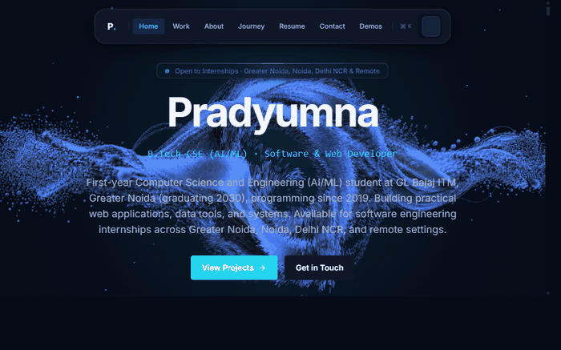
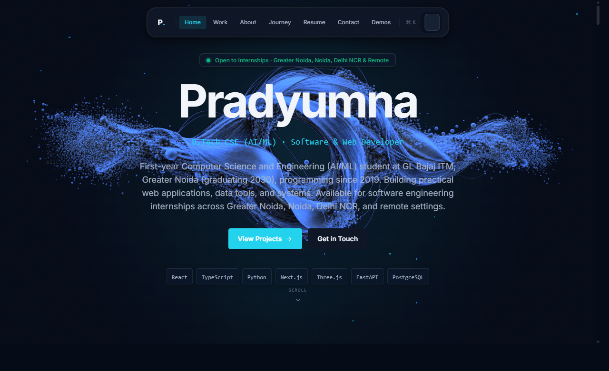
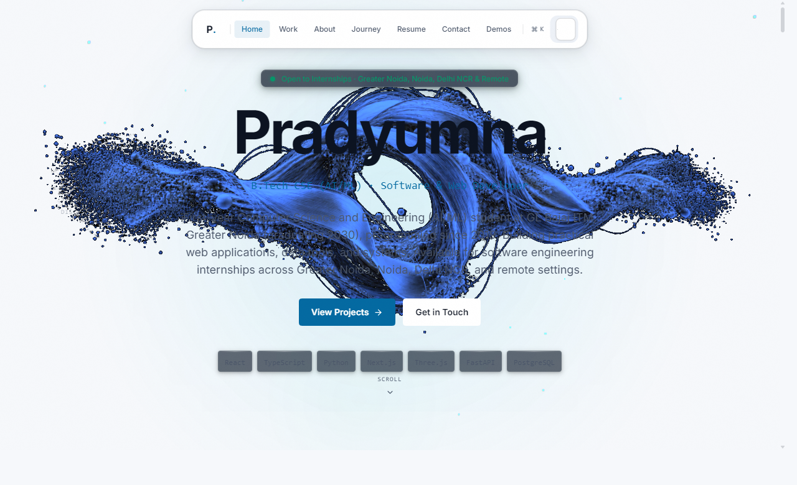
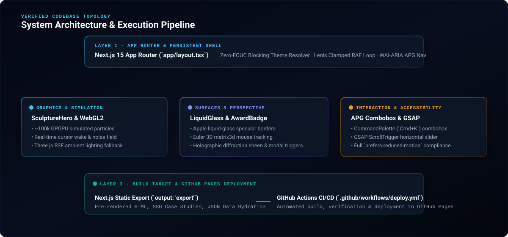

<div align="center">
  <picture>
    <source media="(prefers-color-scheme: dark)" srcset="docs/assets/readme/hero-dark.svg">
    <source media="(prefers-color-scheme: light)" srcset="docs/assets/readme/hero-light.svg">
    
  </picture>

  <p align="center">
    <strong>Personal software engineering portfolio featuring GPU-accelerated liquid particle simulations, Apple-inspired translucent surfaces, mathematically exact 3D perspective transforms, and accessible WAI-ARIA interfaces.</strong>
  </p>

  <p align="center">
    <a href="https://parthparthu.github.io/me/"></a>
    <a href="https://nextjs.org/"></a>
    <a href="https://react.dev/"></a>
    <a href="https://www.typescriptlang.org/"></a>
    <a href="https://threejs.org/"></a>
    <a href="https://tailwindcss.com/"></a>
    <a href="https://github.com/darkroomengineering/lenis"></a>
    <a href="LICENSE"></a>
  </p>

  <p align="center">
    <a href="https://parthparthu.github.io/me/">Live Demo</a> &bull;
    <a href="https://parthparthu.github.io/me/">Component Showcase</a> &bull;
    <a href="#live-experience">Live Experience</a> &bull;
    <a href="#features">Features</a> &bull;
    <a href="#system-architecture">System Architecture</a> &bull;
    <a href="#technology-stack">Tech Stack</a> &bull;
    <a href="#getting-started">Getting Started</a>
  </p>
</div>


## Table of Contents

- [Overview](#overview)
- [Live Experience](#live-experience)
- [Features](#features)
- [System Architecture](#system-architecture)
  - [App Router and Execution Shell](#app-router-and-execution-shell)
  - [GPGPU Particle Simulation Engine](#gpgpu-particle-simulation-engine)
  - [Euler 3D Perspective Matrix and Holographic Foil](#euler-3d-perspective-matrix-and-holographic-foil)
  - [Translucent Surfaces and Lighting Refraction](#translucent-surfaces-and-lighting-refraction)
  - [Independent Dual Theming Engine](#independent-dual-theming-engine)
- [Verified Honours and Credentials](#verified-honours-and-credentials)
- [Technology Stack](#technology-stack)
- [Project Structure](#project-structure)
- [Getting Started](#getting-started)
  - [Prerequisites](#prerequisites)
  - [Installation](#installation)
  - [Development Server](#development-server)
  - [Production Build and Static Export](#production-build-and-static-export)
  - [Verification and Automated Tests](#verification-and-automated-tests)
- [Deployment](#deployment)
- [Accessibility and Engineering Rigor](#accessibility-and-engineering-rigor)
- [Roadmap](#roadmap)
- [Contributing and Security](#contributing-and-security)
- [License](#license)
- [Contact](#contact)


## Overview

This repository contains the complete production source code for the personal engineering portfolio of **Pradyumna Singh**, a First-Year Computer Science and Engineering student (Specialization: AI and Machine Learning) at GL Bajaj Institute of Technology and Management, Greater Noida. Pradyumna is also a Bronze Medalist at the 2023 World Memory Championship.

The website demonstrates production-grade creative engineering, graphics computation, and robust frontend systems architecture:

- **GPGPU Liquid Particle Simulation**: Approximately 100,000 GPU-simulated particles rendered via WebGL2 shaders with continuous procedural noise fields, dynamic cursor wake dissipation, and complement cross-fades.
- **Physical Perspective and Holographic Sheen**: Custom column-major Euler 3D matrix projection and VSYNC-synchronized `requestAnimationFrame` tracking for interactive award badges, featuring iridescent diffraction grating reflection overlays.
- **Apple-Inspired Translucent Surfaces**: Layered specular borders, dynamic pointer-reactive refraction, and ambient drop shadows crafted with CSS custom properties.
- **Virtual-Time Clamped Scrolling**: Clamped virtual-time Lenis requestAnimationFrame loop capping time steps to 33.33ms to eliminate frame skips or clock drift jumps during scrolling.
- **Zero-FOUC Dual Theming**: An inline blocking theme script resolves user system preference before first paint, delivering independent color palettes for dark and light modes with zero flash of unstyled content.
- **WAI-ARIA APG Compliance**: Full keyboard support (`Cmd+K` combobox with active descendant focus, escape key dismissals, visible `:focus-visible` rings, and native system wheel physics).

> [!NOTE]
> The portfolio is pre-rendered as an optimized static export (`output: 'export'`) and continuously deployed to GitHub Pages via automated GitHub Actions CI/CD workflows. Every project metric, achievement, and case study corresponds to genuine competition records and public repositories.


## Live Experience

The animated preview below was captured directly from the running production static export via headless Chromium CDP automation at `1280x820` resolution. It demonstrates the liquid sculpture in motion as the cursor passes over its volume, liquefying the particle material into wake currents before elastically settling back into resting equilibrium.

<div align="center">
  
  <p align="center"><em>Real-time WebGL2 GPGPU particle simulation with cursor wake currents (~100,000 particles)</em></p>
</div>

### Desktop Interface (Dark and Light Modes)

The portfolio provides two distinct visual experiences: an Obsidian dark foundation (`#060B18`) accented by electric cyan and ultraviolet luminescence, and a high-contrast Slate light foundation (`#F8FAFC`) with crisp borders and soft glass shadows.

| Obsidian Dark Mode (Default) | Clean Slate Light Mode |
|:---:|:---:|
|  |  |
| *Hero section with WebGL2 liquid sculpture and cyan illumination* | *High-contrast light mode with crisp borders and subtle glass diffusion* |

### Dedicated Component Showcase Route (`/demos`)

In addition to the primary portfolio homepage, the repository includes an interactive component showcase at `/demos` built with filterable tabs, highlighting individual UI implementations in isolation:

- **Liquid Sculpture Hero**: Full-viewport WebGL2 particle simulation with customizable particle density, wake energy, and return speed controls.
- **GSAP Horizontal Timeline**: Pinned ScrollTrigger storyline with animated SVG connection stems.
- **Shiny CTA Button**: Radial cursor-following specular border reflection with physics damping.
- **Floating Navigation Menu**: Framer Motion layout projection with active indicator transitions.
- **3D Award Badges**: Euler matrix tilt and holographic diffraction grating foil reflections.
- **Vercel Filter Tabs**: Sliding indicator tab bar with keyboard navigation.

Explore the live showcase on the deployed site: [parthparthu.github.io/me](https://parthparthu.github.io/me/) (route: `/demos`).


## Features

Every capability in this repository is substantiated by working source code, strict TypeScript types, and automated verification scripts.

| Feature Area | Component Source | Technical Implementation |
|:---|:---|:---|
| **Interactive Liquid Sculpture** | [`liquid-sculpture-hero.tsx`](components/ui/liquid-sculpture-hero.tsx) | GPU-accelerated GPGPU particle simulation sampling ~100k positions. Custom GLSL shaders calculate ambient Perlin noise displacement, cursor wake dissipation, and complement cross-fades. |
| **Apple Liquid Glass Surfaces** | [`LiquidGlass.tsx`](components/glass/LiquidGlass.tsx) | Multi-layered translucent panels with hairline specular borders, layered drop shadows, and pointer-reactive light refraction based on pointer angle of incidence. |
| **3D Euler Perspective Badges** | [`award-badge.tsx`](components/ui/award-badge.tsx) | Column-major Euler 3D matrix projection (`perspective(700px) matrix3d(...)`) with VSYNC-synchronized `requestAnimationFrame` tracking and 10 prismatic diffraction grating overlay slices. |
| **Zero-FOUC Dual Theming** | [`layout.tsx`](app/layout.tsx) &amp; [`ThemeProvider.tsx`](components/ui/ThemeProvider.tsx) | Blocking inline script executes in `<head>` prior to first paint. Independent CSS custom property design tokens ensure zero flash of unstyled content. |
| **Virtual-Time Clamped Scrolling** | [`SmoothScrollProvider.tsx`](components/common/SmoothScrollProvider.tsx) | Lenis 1.1.18 virtual-time scroll engine. RequestAnimationFrame loop clamps maximum time step to 33.33ms, preventing frame skips or clock drift jumps during scroll events. |
| **Accessible Command Palette** | [`CommandPalette.tsx`](components/ui/CommandPalette.tsx) | WAI-ARIA APG compliant combobox modal triggered via `Cmd+K` / `Ctrl+K`. Features fuzzy search over routes, case studies, external destinations, and theme toggles. |
| **GSAP Horizontal Storyline** | [`timeline.tsx`](components/ui/timeline.tsx) | GSAP 3.15 ScrollTrigger pinned horizontal milestone slider. SVG connection paths animate progressively as the user scrolls horizontally through milestones. |
| **Project Catalog &amp; Case Studies** | [`ProjectsPageClient.tsx`](app/projects/ProjectsPageClient.tsx) | Filterable project directory with dynamic category tabs, technical architecture briefs, source code links, and dedicated slug routes (`/projects/[slug]`). |
| **Substantiated Evidence Modals** | [`AchievementsSection.tsx`](components/sections/AchievementsSection.tsx) | Interactive credential modals showcasing original competition photographs and verified certificates with keyboard focus trapping and `Escape` dismissal. |
| **Validated Contact System** | [`ContactSection.tsx`](components/sections/ContactSection.tsx) | React Hook Form with Zod schema validation. Includes honeypot bot prevention, inline field error focus, and automatic fallback to client `mailto:`. |


## System Architecture

The following diagram illustrates the verified component hierarchy, simulation pipeline, surface rendering, and build workflow of the portfolio:

<div align="center">
  
</div>

### App Router and Execution Shell

The application is structured around Next.js 15 App Router:

1. **`app/layout.tsx`**: Injects an inline blocking script that checks `localStorage` and `window.matchMedia('(prefers-color-scheme: dark)')` prior to rendering. It applies `.dark` or `.light` class to `<html>` to guarantee zero flash of unstyled content.
2. **`components/common/SmoothScrollProvider.tsx`**: Instantiates the Lenis smooth scroll engine. It decouples window scrolling from frame rate stutter by maintaining a virtual scroll accumulator with lerp damping (`lerp: 0.1`).
3. **`components/layout/Header.tsx`**: Provides accessible sticky header navigation with blur backdrop, keyboard trigger for the command palette (`Cmd+K`), and animated theme toggle button.

### GPGPU Particle Simulation Engine

The hero liquid sculpture ([`liquid-sculpture-hero.tsx`](components/ui/liquid-sculpture-hero.tsx)) operates via a dual-buffer GPGPU simulation running on WebGL2:

- **Particle Sampling**: High-density coordinate grids (~100,000 points) are sampled directly from source imagery.
- **Ambient Noise Field**: GLSL fragment shaders compute multi-octave 2D value noise to produce organic undulating drift across the resting sculpture.
- **Cursor Wake Current**: Pointer velocity generates localized energy impulses (`energyAt(rectPx, mouse, radius, presence, wakeEnergy)`). Particles displace outward along the wake vector and elastically return to resting anchor positions over time.
- **Hardware Fallback**: On environments lacking WebGL2 acceleration, the engine displays the crisp source image fallback.

### Euler 3D Perspective Matrix and Holographic Foil

The award badges ([`award-badge.tsx`](components/ui/award-badge.tsx)) use a mathematical Euler 3D projection model:

- **Coordinate Normalization**: Cursor coordinates are normalized relative to the badge center:
  $$\text{normX} = \frac{\text{clientX} - (\text{left} + \text{width}/2)}{\text{width}/2}, \quad \text{normY} = \frac{\text{clientY} - (\text{top} + \text{height}/2)}{\text{height}/2}$$
- **Exact Column-Major 3D Matrix**: Pitch ($\text{rx} = -\text{normY} \cdot 0.175$) and yaw ($\text{ry} = \text{normX} \cdot 0.245$) angles generate a column-major 4x4 matrix applied via CSS `perspective(700px) matrix3d(...)`. At rest or on mouse leave, the matrix returns to identity (`1, 0, 0, 0, 0, 1, 0, 0, 0, 0, 1, 0, 0, 0, 0, 1`).
- **VSYNC Synchronization**: Updates are batched via `requestAnimationFrame`, preventing React render lag or frame drops.
- **Diffraction Grating Sheen**: 10 SVG polygon slices with `mixBlendMode: overlay` and Gaussian blur rotate dynamically based on cursor angle of incidence ($\text{angle} = \text{normX} \cdot 32^\circ + \text{normY} \cdot 12^\circ$), reproducing the optical reflection of authentic metallic foil.

### Translucent Surfaces and Lighting Refraction

UI cards across the application utilize [`LiquidGlass.tsx`](components/glass/LiquidGlass.tsx):

- **Hairline Specular Borders**: Gradient border strokes simulate direct specular light glinting on glass edges.
- **Dynamic Light Refraction**: Pointer movements compute an angle of reflection that shifts radial highlight coordinates in real-time.
- **Layered Shadows**: Ambient room occlusion shadows combined with tight direct drop shadows create authentic elevation tiers.

### Independent Dual Theming Engine

Theme colors are defined through CSS custom properties in [`app/globals.css`](app/globals.css):

- **Obsidian Dark**: `--bg-primary: #060B18`, `--bg-secondary: #0A1020`, `--text-primary: #F8FAFC`, `--accent: #22D3EE`.
- **Clean Slate Light**: `--bg-primary: #F8FAFC`, `--bg-secondary: #F1F5F9`, `--text-primary: #0F172A`, `--accent: #0284C7`.
- **System Synchronization**: Theme switches propagate through `useTheme` context, dynamically re-skinning Three.js scene clear colors, SVG stroke palettes, and UI glass cards.


## Verified Honours and Credentials

All awards and certifications presented on the portfolio are corroborated by official documentation and high-resolution photographs available in [`public/certificates/`](public/certificates/):

| Honour / Credential | Organization &amp; Year | Verification Details | Evidence Modal |
|:---|:---|:---|:---:|
| **Bronze Medal &amp; Top Amateur** | International Association of Memory (IAM), 2023 | Awarded at the 2023 IAM World Memory Championship held at Cidco Exhibition Centre, Navi Mumbai, India (Nov 25-26, 2023). Arbiters: Charifa Souissi, Corinna Draschl, Amrut Jadhav. | [`wmc-2023-bronze-medal.jpg`](public/certificates/wmc-2023-bronze-medal.jpg) |
| **Certified App Developer** | WhiteHat Jr, 2020 | Certificate of Appreciation for exceptional performance in Core Programming, Design Thinking, and Advanced Application Development. | [`certified-app-developer-2020.pdf`](public/certificates/certified-app-developer-2020.pdf) |
| **Certified Game Developer** | WhiteHat Jr, 2020 | Professional game development curriculum certification in 2D physics, coordinate geometry, and event-driven game logic. | [`certified-game-developer-2020.pdf`](public/certificates/certified-game-developer-2020.pdf) |
| **Generative AI Mastermind** | Outskill, 2024 | Certificate of Completion for advanced generative AI and LLM workflows, awarded by Founder Vaibhav Sisinty. | [`generative-ai-outskill.pdf`](public/certificates/generative-ai-outskill.pdf) |


## Technology Stack

The project relies on a modern, strictly typed dependency tree verified from [`package.json`](package.json):

### Framework and Core Architecture

| Technology | Version | Purpose | Documentation |
|:---|:---|:---|:---|
| **Next.js** | `15.0.3` | App Router, static SSG page pre-rendering, code splitting | [nextjs.org](https://nextjs.org/) |
| **React** | `19.0.0` | Component composition, Concurrent React, hooks architecture | [react.dev](https://react.dev/) |
| **React DOM** | `19.0.0` | Client-side DOM mounting and hydration | [react.dev](https://react.dev/) |
| **TypeScript** | `5.7.2` | Static typing, interface definitions, compiler typecheck | [typescriptlang.org](https://www.typescriptlang.org/) |

### 3D Graphics and Simulation

| Technology | Version | Purpose | Documentation |
|:---|:---|:---|:---|
| **WebGL2** | Native | GPGPU liquid particle physics and GLSL noise shaders | [khronos.org](https://www.khronos.org/webgl/) |
| **Three.js** | `0.186.1` | Scene graph management, 3D math, and ambient lighting | [threejs.org](https://threejs.org/) |
| **@react-three/fiber** | `9.8.1` | Declarative Three.js scene composition in React | [docs.pmnd.rs/react-three-fiber](https://docs.pmnd.rs/react-three-fiber) |
| **@react-three/drei** | `10.7.9` | R3F helpers, cameras, and procedural geometry primitives | [docs.pmnd.rs/drei](https://docs.pmnd.rs/drei) |
| **detect-gpu** | `5.0.70` | Client GPU tier classification for adaptive performance | [github.com/pmndrs/detect-gpu](https://github.com/pmndrs/detect-gpu) |

### Animation and Motion

| Technology | Version | Purpose | Documentation |
|:---|:---|:---|:---|
| **Framer Motion** | `11.11.0` | UI component transitions, layout projection, scroll transforms | [motion.dev](https://motion.dev/) |
| **Lenis** | `1.1.18` | Virtual-time clamped smooth scrolling engine | [lenis.darkroom.engineering](https://lenis.darkroom.engineering/) |
| **GSAP** | `3.15.0` | ScrollTrigger timeline, pinned horizontal slider | [greensock.com/gsap](https://greensock.com/gsap/) |
| **@gsap/react** | `2.1.2` | React integration hooks for safe GSAP lifecycle cleanup | [greensock.com/react](https://greensock.com/react/) |

### Styling, Components, and Forms

| Technology | Version | Purpose | Documentation |
|:---|:---|:---|:---|
| **Tailwind CSS** | `3.4.15` | Utility-first styling with custom design tokens | [tailwindcss.com](https://tailwindcss.com/) |
| **Radix UI Dialog** | `1.3.1` | Accessible modal dialog primitives with focus trapping | [radix-ui.com](https://www.radix-ui.com/) |
| **Lucide React** | `0.454.0` | Accessible iconography system | [lucide.dev](https://lucide.dev/) |
| **React Hook Form** | `7.53.2` | High-performance uncontrolled form state management | [react-hook-form.com](https://react-hook-form.com/) |
| **Zod** | `3.23.8` | Schema declaration and form input data validation | [zod.dev](https://zod.dev/) |
| **Zustand** | `5.0.15` | Lightweight client state store for scroll and UI status | [zustand-demo.pmnd.rs](https://zustand-demo.pmnd.rs/) |


## Project Structure

```
me/
├── app/                              # Next.js 15 App Router
│   ├── layout.tsx                    # Root layout with 0-FOUC theme resolver
│   ├── page.tsx                      # Main homepage composed of core sections
│   ├── globals.css                   # Design tokens, CSS custom properties, utility rules
│   ├── demos/page.tsx                # Dedicated interactive UI component showcase
│   └── projects/                     # Project index and dynamic case study routes
│       ├── page.tsx                  # Filterable project catalog page
│       └── [slug]/page.tsx           # Individual project case study dynamic page
├── components/                       # Modular UI and architectural components
│   ├── canvas/                       # Three.js 3D persistent canvas and scene container
│   ├── common/                       # SmoothScrollProvider (Lenis RAF loop)
│   ├── glass/                        # LiquidGlass translucent surfaces and GlassButtons
│   ├── layout/                       # Header, navigation drawer, theme toggle, footer
│   ├── sections/                     # Section components (Hero, Projects, Achievements, Contact)
│   └── ui/                           # Primitive UI components
│       ├── award-badge.tsx           # Euler 3D perspective badge with holographic foil
│       ├── CommandPalette.tsx        # WAI-ARIA APG combobox modal (Cmd+K)
│       ├── liquid-sculpture-hero.tsx # WebGL2 GPGPU particle simulation centerpiece
│       ├── timeline.tsx              # GSAP ScrollTrigger horizontal milestone slider
│       └── vercel-tabs.tsx           # Vercel-style sliding indicator filter tabs
├── data/                             # Verified static data models
│   ├── achievements.ts               # Competition medals, arbiters, and certificate records
│   ├── projects.ts                   # Projects, technical case studies, and live URLs
│   └── skills.ts                     # Engineering competencies and technical toolchains
├── docs/                             # Documentation and verification assets
│   └── assets/readme/                # Dedicated README visual assets and diagrams
├── hooks/                            # Custom React hooks (useSmoothScroll, useMediaQuery)
├── lib/                              # Utility helpers, cn class merge, parallax configs
├── public/                           # Static public assets, certificates, and WebP models
│   ├── certificates/                 # Original medal photographs and verification PDFs
│   └── images/sculpture/             # WebP sculpture reference imagery
├── scripts/                          # Automated CDP testing, capture, and verification suites
└── next.config.ts                    # Static export configuration and basePath settings
```


## Getting Started

### Prerequisites

- **Node.js**: `20.x` or higher (verified on Node `22.x` and `24.x`).
- **Package Manager**: `npm` (v10+).
- **Modern Browser**: Chrome, Edge, Firefox, or Safari with WebGL2 support.

### Installation

Clone the repository and install dependencies:

```bash
git clone https://github.com/Parthparthu/me.git
cd me
npm install
```

### Development Server

Start the Next.js local development server with Turbopack:

```bash
npm run dev
```

Open [http://localhost:3000](http://localhost:3000) in your browser.

### Production Build and Static Export

The project pre-renders all 22 routes into a standalone static HTML export in the `out/` directory:

```bash
npm run build
```

This execution runs `scripts/fetch-github-activity.mjs` during `prebuild` to cache real GitHub commit metrics, followed by `next build` static page generation.

### Verification and Automated Tests

The repository contains automated test suites that run via headless Chrome CDP to verify 3D transforms, accessibility interactions, and rendering integrity:

```bash
# Run TypeScript compilation check
npm run typecheck

# Run Next.js and ESLint code quality checks
npm run lint

# Verify Award Badge 3D Euler matrix tilt and modal interactions
node scripts/verify-award-badge.mjs

# Verify Achievements section photo modals and document links
node scripts/smoke-test-achievements.mjs
```


## Deployment

The portfolio is deployed to GitHub Pages: [parthparthu.github.io/me](https://parthparthu.github.io/me/)

### Automated Continuous Deployment Pipeline

Production deployment is fully automated via GitHub Actions in [`.github/workflows/deploy.yml`](.github/workflows/deploy.yml):

1. **Trigger**: Pushes to the `main` branch automatically dispatch the deployment workflow.
2. **Build Stage**: Node.js environment is configured, dependencies installed, and `npm run build` generates the static `out/` export.
3. **Artifact Upload**: The generated static directory is bundled and uploaded via `actions/upload-pages-artifact@v3`.
4. **Pages Release**: The artifact is deployed directly to GitHub Pages via `actions/deploy-pages@v4`.

### Base Path Configuration

In [`next.config.ts`](next.config.ts), the base path is conditionally set to `/me` when building for GitHub Pages production:

```typescript
const isProd = process.env.NODE_ENV === 'production';
const basePath = isProd ? '/me' : '';
```

All asset references and routing links use the `getAssetPath()` utility in [`lib/utils.ts`](lib/utils.ts) to guarantee portability between local root development (`http://localhost:3000/`) and GitHub Pages hosting: [parthparthu.github.io/me](https://parthparthu.github.io/me/)


## Accessibility and Engineering Rigor

The application adheres strictly to the WAI-ARIA Authoring Practices Guide (APG) and web engineering best practices:

- **Keyboard Trapping and Navigation**: Modal dialogs trap focus upon opening, return focus to the originating trigger upon closure, and dismiss immediately on `Escape`. The command palette (`Cmd+K`) functions as an accessible combobox with keyboard arrow selection.
- **Visible Focus Replacement**: Zero `outline: none` occurrences without visible high-contrast focus rings (`:focus-visible`). Focus rings use `--focus-ring: #22D3EE` with offset contrast rings.
- **Motion Accessibility (`prefers-reduced-motion`)**: When a user enables reduced motion in their operating system, the liquid sculpture particle simulation disables displacement, the award badge 3D perspective matrix is suppressed, and parallax scroll rates collapse to zero.
- **Mobile Touch Targets**: All interactive elements (buttons, links, badges, form controls) enforce a minimum hit target of 44 &times; 44 pixels.
- **Typography and Contrast**: Text elements exceed WCAG AA contrast standards across both dark and light modes, avoiding dark gradient banding and color-only status indicators.


## Roadmap

Development milestones are tracked honestly according to repository commits and real development goals:

- [x] **Liquid Sculpture Centerpiece**: Implement WebGL2 GPGPU particle simulation in place of the old 3D crystal.
- [x] **Euler 3D Matrix Badges**: Mathematical 4x4 matrix tilt and holographic foil reflection for competitive honours.
- [x] **Dedicated `/demos` Route**: Isolated interactive showcase for UI components, GSAP timeline, and buttons.
- [x] **Static SSG Export**: 22 statically exported pages with zero-FOUC dual theming on GitHub Pages.
- [ ] **Interactive Case Study Benchmarks**: Add live interactive performance telemetry graphs inside individual project pages.
- [ ] **Automated Playwright CI Matrix**: Integrate end-to-end multi-browser test coverage into the GitHub Actions pipeline.


## Contributing and Security

Contributions, bug reports, and suggestions are welcome:

1. Fork the repository.
2. Create a feature branch (`git checkout -b feature/improvement`).
3. Commit your changes with clear messages (`git commit -m "feat: improve liquid particle damping"`).
4. Run validation checks (`npm run typecheck && npm run lint`).
5. Push to the branch and open a Pull Request.

To report security vulnerabilities or configuration defects, please open a private GitHub issue or contact Pradyumna directly.


## License

This project is licensed under the MIT License -- see the [LICENSE](LICENSE) file for details.


## Contact

- **Name**: Pradyumna Singh
- **Website**: [parthparthu.github.io/me](https://parthparthu.github.io/me/)
- **GitHub**: [@Parthparthu](https://github.com/Parthparthu)
- **LinkedIn**: [linkedin.com/in/pradyumna05](https://www.linkedin.com/in/pradyumna05)

<p align="center">
  <a href="#table-of-contents">Back to top &uarr;</a>
</p>
