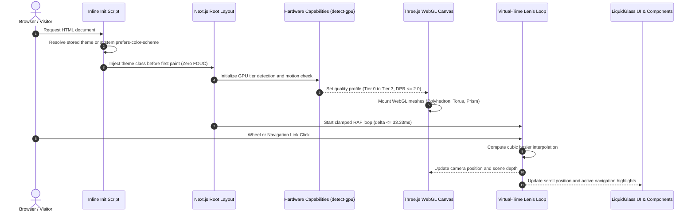

<!-- Build Palette: Primary Cyan (#06b6d4), Supporting Emerald (#10b981), Supporting Amber (#f59e0b) -->

<div align="center">
  <picture>
    <source media="(prefers-color-scheme: dark)" srcset="docs/assets/hero-banner-dark.svg">
    <source media="(prefers-color-scheme: light)" srcset="docs/assets/hero-banner-light.svg">
    
  </picture>

  <p align="center">
    <strong>Production-grade engineering portfolio featuring theme-reactive Three.js WebGL, liquid-glass refraction filters, clamped virtual-time smooth scrolling, and accessible WAI-ARIA interfaces.</strong>
  </p>

  <p align="center">
    <a href="https://parthparthu.github.io/me/"></a>
    <a href="https://nextjs.org/"></a>
    <a href="https://react.dev/"></a>
    <a href="https://www.typescriptlang.org/"></a>
    <a href="https://threejs.org/"></a>
    <a href="https://tailwindcss.com/"></a>
    <a href="https://github.com/darkroomengineering/lenis"></a>
    
  </p>
</div>

---

## Table of Contents

- [Overview](#overview)
- [System Architecture](#system-architecture)
- [Core Features and Technical Deep-Dives](#core-features-and-technical-deep-dives)
  - [1. Theme-Reactive 3D WebGL Canvas](#1-theme-reactive-3d-webgl-canvas)
  - [2. Clamped Virtual-Time Smooth Scrolling](#2-clamped-virtual-time-smooth-scrolling)
  - [3. Liquid-Glass Refraction Engine](#3-liquid-glass-refraction-engine)
  - [4. Zero-FOUC Dual Theme System](#4-zero-fouc-dual-theme-system)
  - [5. Accessible Command Palette](#5-accessible-command-palette)
  - [6. Project Catalog and Case Studies](#6-project-catalog-and-case-studies)
  - [7. Validated Contact System and Bot Defense](#7-validated-contact-system-and-bot-defense)
  - [8. Accessibility and Interaction Standards](#8-accessibility-and-interaction-standards)
- [Visual Interface Showcase](#visual-interface-showcase)
- [Technology Stack and Exact Versions](#technology-stack-and-exact-versions)
- [Repository Structure](#repository-structure)
- [Configuration and Feature Flags](#configuration-and-feature-flags)
- [Getting Started](#getting-started)
- [Automated Verification and QA Suites](#automated-verification-and-qa-suites)
- [License and Author](#license-and-author)

---

## Overview

This repository contains the full source code for the personal engineering portfolio of **Pradyumna**, a First-Year Computer Science and Engineering student (Specialization: AI and Machine Learning) at GL Bajaj Institute of Technology and Management, Greater Noida. Pradyumna is also a Bronze Medalist at the 2023 World Memory Championship.

The site is built to demonstrate production-grade front-end and systems engineering principles:
- **WebGL 3D Acceleration**: An ambient Three.js scene utilizing procedural glass geometries, real-time light calculation, and hardware capability tiers.
- **Physics and Interpolation**: Custom virtual-time Lenis requestAnimationFrame loop preventing clock drift, frame dropping, or abrupt teleports during page scrolling.
- **Universal Design Tokens**: Independent dark and light themes crafted with CSS custom properties, ensuring high-contrast readability without inverted color artifacts.
- **Zero Hacks**: Complete compliance with WAI-ARIA Authoring Practices Guide (APG), native system cursor, predictable native wheel physics, and zero marketing filler.

> [!NOTE]
> The portfolio is pre-rendered as a static export and deployed continuously via GitHub Actions to GitHub Pages. All project case studies, metrics, and achievements reflect verified codebases and competition records.

---

## System Architecture

The application pipeline is organized into five decoupled layers. Hardware capabilities and user preferences govern the WebGL rendering tier, while a clamped virtual-time clock synchronizes smooth scrolling with Next.js DOM components.

<div align="center">
  <picture>
    <source media="(prefers-color-scheme: dark)" srcset="docs/assets/architecture-dark.svg">
    <source media="(prefers-color-scheme: light)" srcset="docs/assets/architecture-light.svg">
    
  </picture>
</div>

### Architectural Data Flow



---

## Core Features and Technical Deep-Dives

### 1. Theme-Reactive 3D WebGL Canvas

The 3D background is powered by **Three.js 0.186**, **React Three Fiber (R3F)**, and **Drei**. It delivers depth without interfering with foreground readability or device thermals.

- **Procedural Glass Meshes**:
  - Central rounded glass polyhedron (`MeshPhysicalMaterial` with transmission, roughness 0.15, and clearcoat).
  - Floating glass torus acting as an orbital focal ring.
  - Secondary accent refraction prism reflecting background lights.
- **Theme-Reactive Three-Point Lighting**:
  - Key Light: Deep technical cyan in dark mode (`#0891b2`), soft sky blue in light mode (`#0284c7`).
  - Fill Light: Electric emerald in dark mode (`#059669`), mint emerald in light mode (`#10b981`).
  - Specular Rim Light: Warm amber highlight creating crisp contrast along geometry edges.
- **Pointer-Reactive Scene Tilt**:
  - When pointer moves across the viewport, the camera and geometry rotate gently with inertial damping.
  - Controlled by a single global flag: `export const POINTER_REACTIVE_3D = true;` in [`lib/config.ts`](lib/config.ts).
- **GPU Tier Management**:
  - Benchmarked via `detect-gpu`.
  - Automatically steps down shadows, post-processing passes, and geometry density on low-power devices.
  - Automatically throttles to 0 FPS when the tab is hidden or canvas is scrolled out of viewport.

---

### 2. Clamped Virtual-Time Smooth Scrolling

Native wheel scrolling and anchor navigation are orchestrated through **Lenis 1.1.18** with custom synchronization to prevent timing discontinuities.

- **The Clock Drift Solution**:
  - Standard smooth-scroll libraries can cause single-frame jumping if browser tab throttling or initial loading delays introduce a large time gap (such as `elapsed > 1000ms`).
  - [`components/common/SmoothScrollProvider.tsx`](components/common/SmoothScrollProvider.tsx) implements a clamped virtual-time accumulator:
    ```typescript
    const elapsed = Math.max(0, now - lastTimeRef.current);
    const clampedDelta = Math.min(elapsed, 33.33); // Enforce max 30 FPS step
    virtualTimeRef.current += clampedDelta;
    lenisRef.current.raf(virtualTimeRef.current);
    ```
- **Unified Navigation Hook**:
  - [`hooks/useSmoothScroll.ts`](hooks/useSmoothScroll.ts) calculates exact target pixel coordinates relative to the header dock offset (-60px).
  - Handles desktop navigation links, mobile drawer links, hero action buttons, command palette jumps, and back-to-top buttons through one consistent interface.
- **Deep Linking and History**:
  - Uses `window.history.pushState` deferred until the animation completes (`onComplete`), preventing browser history resets from cancelling ongoing scroll motions.
- **Accessibility Safeguard**:
  - Automatically checks `prefers-reduced-motion: reduce`. When active, animations are disabled and replaced with instantaneous scrolling.

---

### 3. Liquid-Glass Refraction Engine

The visual design is founded on a custom liquid-glass design system implemented via [`components/glass/LiquidGlass.tsx`](components/glass/LiquidGlass.tsx) and [`components/glass/GlassSVGFilter.tsx`](components/glass/GlassSVGFilter.tsx).

- **Multi-Layer Optical Model**:
  - **Backdrop Blur**: Dual-layer CSS blur (`backdrop-filter: blur(16px)`).
  - **Specular Highlights**: Multi-stop linear gradients mapped to outer borders (`1px solid var(--border-glass)`).
  - **Layered Dual Shadows**: An ambient diffuse shadow paired with a sharp directional drop shadow to simulate glass thickness.
  - **SVG Displacement Filter**: An SVG filter with `feTurbulence` and `feDisplacementMap` primitives simulates real-time micro-refraction along card perimeters.
- **Token Consistency**:
  - Surfaces use semantic variables (`--glass-surface`, `--glass-specular`, `--glass-shadow`) tuned independently for dark and light modes.

---

### 4. Zero-FOUC Dual Theme System

Theming is engineered as two deliberate visual identities rather than a simple mathematical color inversion.

- **Inline Initializer**:
  - An inline script in [`app/layout.tsx`](app/layout.tsx) executes synchronously before CSS hydration to read `localStorage` or `window.matchMedia('(prefers-color-scheme: dark)')`.
  - Sets the `theme-dark` or `theme-light` class on the `<html>` root, preventing any Flash of Unstyled Content (FOUC).
- **Synchronized Meta Theme Color**:
  - The `<meta name="theme-color">` dynamically updates between `#080c14` (dark) and `#f8fafc` (light) to integrate with mobile browser address bars.
- **Favicon Sync**:
  - Favicon dynamically mirrors active theme contrast to remain distinct in dark and light browser tab bars.

---

### 5. Accessible Command Palette

Available across all pages via the global keyboard shortcut **`Cmd + K`** (macOS) or **`Ctrl + K`** (Windows/Linux).

- Built per WAI-ARIA Combobox design patterns with active descendant management (`aria-activedescendant`).
- Real-time client-side fuzzy search across:
  - Navigation targets (Home, Selected Work, Technical Skills, Journey, Contact).
  - Project directory case studies with direct routing.
  - Curriculum Vitae view (`/resume`).
  - External profiles (GitHub, LinkedIn, Email).
  - Quick theme toggling (Dark Mode / Light Mode).
- Accessible focus return to the previously focused trigger element upon close.

---

### 6. Project Catalog and Case Studies

Projects are modeled in [`data/projects.ts`](data/projects.ts) with complete engineering context, technical architectural decisions, live URLs, and source repositories.

- **Category Filtering**: Instant client-side filtering across Full-Stack, AI / Systems, and Web Applications.
- **Dedicated Case Study Pages**: Route `/projects/[slug]` renders detailed project briefs, problem statements, technology stacks, and architecture highlights.
- **Lightbox Previews**: Fast modal inspections directly from the main project catalog grid.

---

### 7. Validated Contact System and Bot Defense

The contact section includes an accessible form built with **React Hook Form** and **Zod** schema validation.

- **Client Validation**: Inline error messages linked via `aria-describedby` with automatic focus to the first invalid field on submission.
- **Honeypot Bot Trap**: A hidden field (`tabIndex={-1}`, `aria-hidden="true"`, hidden via absolute positioning) detects automated form fillers without disturbing screen readers.
- **Delivery Strategy**:
  - If `RESEND_API_KEY` is present in environment variables, the form dispatches via the serverless API route [`app/api/contact/route.ts`](app/api/contact/route.ts).
  - If no API key is configured, the form seamlessly transitions to a pre-filled `mailto:` client fallback.

---

### 8. Accessibility and Interaction Standards

The entire repository strictly enforces modern web accessibility and usability standards:

- **Hit Targets**: All interactive targets (buttons, links, form inputs) have a minimum hit area of 44px on touch devices and 24px on desktop.
- **Focus Rings**: High-contrast, unobscured `:focus-visible` rings styled with `var(--focus-ring)`.
- **System Cursor**: Completely native cursor with zero custom follower lag or magnetic cursor scripts.
- **Natural Scrolling**: Zero scroll-jacking, zero forced page snap, and predictable wheel inertia.
- **Zero Em Dashes**: Clean, precise typography with zero em dashes anywhere in code, markdown, or metadata.
- **Zero Emoji as Icons**: Professional vector icons sourced strictly from **Lucide React**.

---

## Visual Interface Showcase

### Desktop Experience (Dark and Light Modes)

| Dark Mode (Default) | Light Mode (High Contrast) |
|:---:|:---:|
|  |  |
| *Hero section with ambient WebGL 3D glass and cyan glow* | *Clean slate light mode with crisp borders and soft glass shadows* |

### Interactive Command Palette (`Cmd + K`)

| Dark Command Palette | Light Command Palette |
|:---:|:---:|
|  |  |

### Selected Work and Case Studies

| Dark Projects Grid | Light Projects Grid |
|:---:|:---:|
|  |  |

---

## Technology Stack and Exact Versions

All versions are pinned in [`package.json`](package.json):

| Category | Package | Version | Purpose |
|:---|:---|:---|:---|
| **Core Framework** | `next` | `^15.0.3` | App Router, Server Components, Static Export |
| **UI Library** | `react` | `^19.0.0` | Declarative UI and React 19 hooks |
| | `react-dom` | `^19.0.0` | DOM rendering and portal mounting |
| **Language** | `typescript` | `^5.7.2` | Static typing, interface definitions |
| **3D & Graphics** | `three` | `^0.186.1` | WebGL 3D rendering engine and shaders |
| | `@react-three/fiber` | `^9.8.1` | Declarative Three.js component wrapper |
| | `@react-three/drei` | `^10.7.9` | 3D helpers, shaders, and camera utilities |
| | `@react-spring/three` | `^10.1.2` | Spring physics for 3D coordinate transforms |
| | `detect-gpu` | `^5.0.70` | Hardware benchmark for dynamic quality tiers |
| | `postprocessing` | `^6.39.5` | WebGL post-processing passes |
| | `@react-three/postprocessing` | `^3.1.3` | React integration for post-processing |
| **Animation & Scroll** | `lenis` | `^1.1.18` | Virtual smooth scrolling and RAF engine |
| | `framer-motion` | `^11.11.0` | UI transitions, layout animations, modals |
| | `gsap` | `^3.15.0` | High-performance timeline animation engine |
| | `@gsap/react` | `^2.1.2` | React hooks for GSAP animations |
| **Styling & Icons** | `tailwindcss` | `^3.4.15` | Utility-first CSS styling system |
| | `@tailwindcss/typography` | `^0.5.15` | Prose formatting for long-form case studies |
| | `lucide-react` | `^0.454.0` | Accessible vector SVG icons |
| | `clsx` | `^2.1.1` | Conditional class name concatenation |
| **State & Forms** | `zustand` | `^5.0.15` | Lightweight client state management |
| | `react-hook-form` | `^7.53.2` | Controlled and uncontrolled form validation |
| | `zod` | `^3.23.8` | TypeScript-first schema declaration |
| | `@hookform/resolvers` | `^3.9.1` | Zod resolver integration for React Hook Form |
| **Email Services** | `resend` | `^4.0.1` | Transactional email delivery API |
| **Build & Tooling** | `eslint` | `^9.14.0` | Code quality and linting |
| | `postcss` | `^8.4.49` | CSS post-processing pipeline |
| | `autoprefixer` | `^10.4.20` | Vendor prefix automation |

---

## Repository Structure

```text
Portfolio/
├── app/
│   ├── api/contact/route.ts      # Serverless email dispatch handler
│   ├── privacy/page.tsx          # Privacy Policy compliance page
│   ├── projects/                 # Projects catalog and individual case studies
│   │   ├── page.tsx
│   │   ├── ProjectsPageClient.tsx
│   │   └── [slug]/page.tsx
│   ├── resume/page.tsx           # Curriculum Vitae and experience brief
│   ├── terms/page.tsx            # Terms of Service compliance page
│   ├── globals.css               # Design tokens, CSS variables, utilities
│   ├── icon.svg                  # Dynamic vector favicon
│   ├── layout.tsx                # Root layout, theme script, typography
│   ├── loading.tsx               # Route suspension fallback
│   ├── not-found.tsx             # 404 error page with navigation recovery
│   ├── page.tsx                  # Single-page portfolio composition
│   ├── robots.ts                 # Search engine crawler instructions
│   ├── sitemap.ts                # Dynamic XML sitemap generator
│   └── template.tsx              # Page transition animator
├── components/
│   ├── canvas/                   # WebGL Three.js background canvas and shaders
│   │   ├── SceneCanvas.tsx
│   │   ├── LiquidGlassScene.tsx
│   │   └── AdaptivePixelRatio.tsx
│   ├── common/                   # Providers and client overlays
│   │   ├── ClientOverlays.tsx
│   │   └── SmoothScrollProvider.tsx
│   ├── glass/                    # Liquid-glass card components and SVG filters
│   │   ├── LiquidGlass.tsx
│   │   ├── GlassVariants.tsx
│   │   └── GlassSVGFilter.tsx
│   ├── layout/                   # Header dock, mobile drawers, and Footer
│   │   ├── Header.tsx
│   │   ├── Footer.tsx
│   │   └── Preloader.tsx
│   ├── sections/                 # Main portfolio content rooms
│   │   ├── HeroSection.tsx
│   │   ├── SelectedWork.tsx
│   │   ├── CurrentlyBuilding.tsx
│   │   ├── SkillsSection.tsx
│   │   ├── JourneySection.tsx
│   │   ├── AboutSection.tsx
│   │   └── ContactSection.tsx
│   └── ui/                       # Reusable UI controls and dialogs
│       ├── CommandPalette.tsx
│       ├── ThemeProvider.tsx
│       ├── BackToTop.tsx
│       └── SkipLink.tsx
├── data/                         # Verified portfolio facts and case studies
│   ├── achievements.ts
│   ├── journey.ts
│   ├── profile.ts
│   ├── projects.ts
│   ├── skills.ts
│   └── socials.ts
├── docs/assets/                  # SVG diagrams, banners, and real screenshots
├── hooks/
│   └── useSmoothScroll.ts        # Unified Lenis smooth-scroll orchestration
├── lib/
│   ├── config.ts                 # Global feature flags and performance limits
│   └── utils.ts                  # Classname merging and formatting helpers
├── public/                       # Static public assets, fonts, icons
├── scripts/                      # Automated browser verification and QA test suites
├── .env.example                  # Environment configuration template
├── package.json                  # Dependencies, scripts, and engine metadata
├── tailwind.config.ts            # Tailwind CSS design system configuration
└── tsconfig.json                 # TypeScript compiler configuration
```

---

## Configuration and Feature Flags

Global application behavior is centralized in [`lib/config.ts`](lib/config.ts):

```typescript
// Enable or disable pointer-reactive 3D scene tilt and card lighting with one toggle
export const POINTER_REACTIVE_3D = true;

// Preloader display configuration
export const PRELOADER_CONFIG = {
  enabled: true,
  maxDurationMs: 1600,
  minSkippableMs: 500,
  sessionKey: 'pradyuma_portfolio_preloader_seen',
};

// Hardware performance configuration
export const QUALITY_CONFIG = {
  defaultDesktop: 'high' as const,
  defaultMobile: 'high' as const,
  maxPixelRatio: 2,
  enablePostProcessing: true,
};
```

---

## Getting Started

### Prerequisites

- **Node.js**: `v18.18.0` or higher (Node.js 20+ LTS recommended)
- **Package Manager**: `npm` (v9 or v10)

### 1. Clone the Repository

```bash
git clone https://github.com/Parthparthu/me.git
cd me
```

### 2. Install Dependencies

```bash
npm install
```

### 3. Configure Environment Variables

Copy the template file to `.env.local`:

```bash
cp .env.example .env.local
```

| Variable | Required | Description | Default |
|:---|:---:|:---|:---|
| `NEXT_PUBLIC_SITE_URL` | No | Base URL for metadata and Open Graph links | `https://parthparthu.github.io/me` |
| `NEXT_PUBLIC_BASE_PATH` | No | Base path for subpath GitHub Pages hosting | `""` |
| `RESEND_API_KEY` | No | Resend API key for contact form submission | `""` (falls back to `mailto:`) |
| `CONTACT_EMAIL` | No | Destination email for contact messages | `pradyumna05@outlook.in` |

### 4. Run Development Server

Start the local development server with Next.js Turbopack:

```bash
npm run dev
```

Open [http://localhost:3000](http://localhost:3000) in your browser to view the application.

### 5. Production Build

Build the static export bundle for production:

```bash
npm run build
```

The compiled output will be generated in the `out/` directory, ready for hosting on GitHub Pages, Cloudflare Pages, or Vercel.

---

## Automated Verification and QA Suites

This repository includes a suite of automated scripts in `scripts/` to ensure regression-free code and design integrity:

### 1. Standards and Constraints Audit

Verifies zero em dashes, zero prohibited phrases, zero custom cursors, zero emojis as icons, and strict border radii:

```bash
node scripts/verify-standards.cjs
```

### 2. Nav Scroll Animation Verification

Automated Chrome and Edge DevTools Protocol (CDP) test that verifies multi-frame smooth interpolated scrolling on all navigation triggers:

```bash
node scripts/verify-nav-scroll.mjs
```

### 3. Responsive Matrix Verification

Tests responsive rendering and touch target sizing across mobile, tablet, desktop, and ultrawide viewports:

```bash
node scripts/verify-responsive-matrix.mjs
```

### 4. Static Analysis and Typechecking

```bash
npm run typecheck
npm run lint
```

---

## License and Author

- **Author**: [Pradyumna](https://github.com/Parthparthu)
- **Institution**: GL Bajaj Institute of Technology and Management, Greater Noida
- **Contact**: `pradyumna05@outlook.in`
- **License**: Released under the [MIT License](LICENSE).
