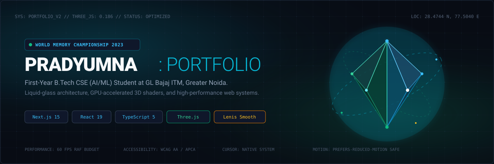
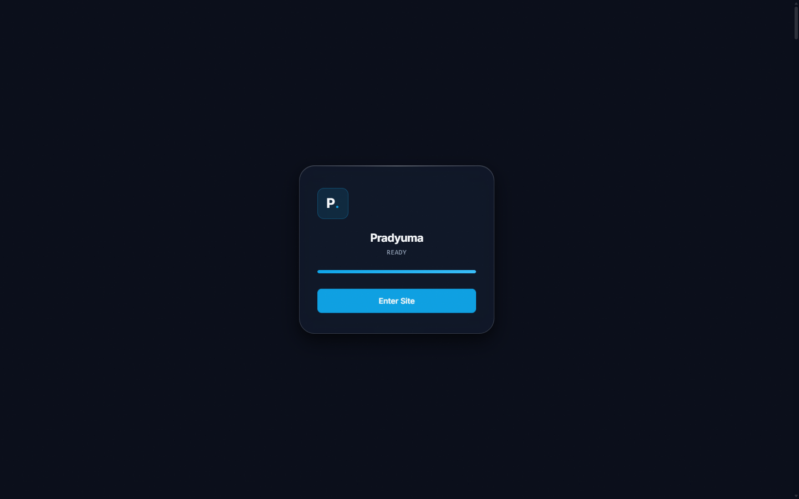
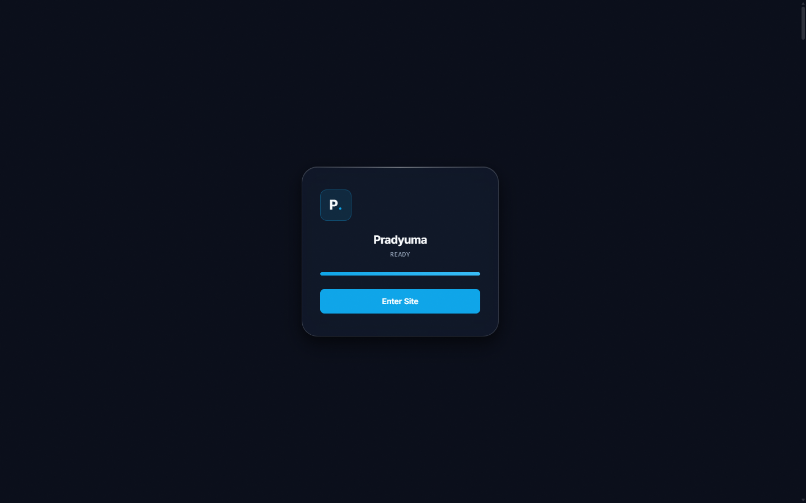
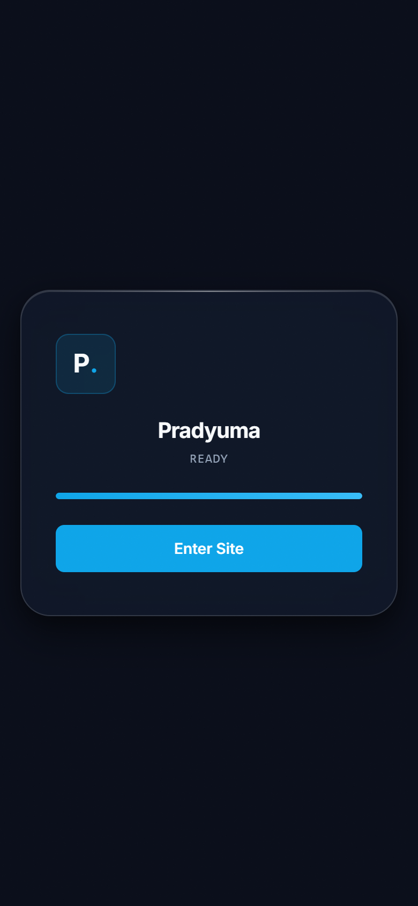
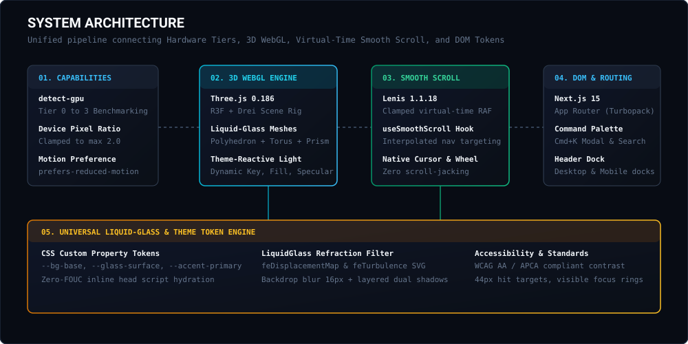
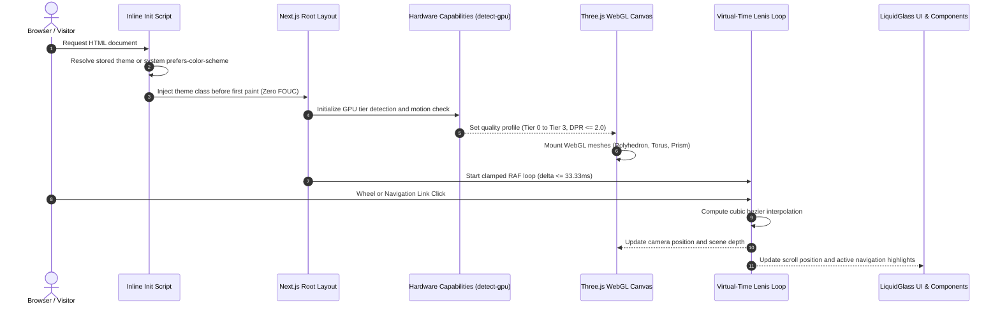

<!-- Build Palette: Primary Sky Blue (#0ea5e9, #0284c7), Supporting Emerald (#10b981, #059669), Supporting Amber (#f59e0b, #d97706) -->

<div align="center">
  <picture>
    <source media="(prefers-color-scheme: dark)" srcset="docs/assets/hero-banner-dark.svg">
    <source media="(prefers-color-scheme: light)" srcset="docs/assets/hero-banner-light.svg">
    
  </picture>

  <p align="center">
    <strong>Personal software engineering portfolio featuring a single persistent WebGL 3D canvas, Apple-inspired translucent surfaces, multi-layer depth parallax, and accessible WAI-ARIA interfaces.</strong>
  </p>

  <p align="center">
    <a href="https://parthparthu.github.io/me/"></a>
    <a href="https://nextjs.org/"></a>
    <a href="https://react.dev/"></a>
    <a href="https://www.typescriptlang.org/"></a>
    <a href="https://threejs.org/"></a>
    <a href="https://tailwindcss.com/"></a>
    <a href="https://github.com/darkroomengineering/lenis"></a>
    <a href="LICENSE"></a>
  </p>

  <p align="center">
    <a href="https://parthparthu.github.io/me/">Live Demo</a> &bull;
    <a href="#preview">Preview</a> &bull;
    <a href="#features">Features</a> &bull;
    <a href="#tech-stack">Tech Stack</a> &bull;
    <a href="#how-it-works">How It Works</a> &bull;
    <a href="#getting-started">Getting Started</a>
  </p>
</div>

<picture>
  <source media="(prefers-color-scheme: dark)" srcset="docs/assets/divider-dark.svg">
  <source media="(prefers-color-scheme: light)" srcset="docs/assets/divider-light.svg">
  
</picture>

## Table of Contents

- [Overview](#overview)
- [Preview](#preview)
- [Features](#features)
- [Tech Stack](#tech-stack)
- [How It Works](#how-it-works)
  - [Architecture Overview](#architecture-overview)
  - [Rendering Pipeline](#rendering-pipeline)
  - [Theming System](#theming-system)
  - [Interaction and Animation Layers](#interaction-and-animation-layers)
  - [Performance and Quality Model](#performance-and-quality-model)
  - [Contact Form Request and Data Flow](#contact-form-request-and-data-flow)
- [Project Structure](#project-structure)
- [Getting Started](#getting-started)
  - [Prerequisites](#prerequisites)
  - [Installation](#installation)
  - [Environment Variables](#environment-variables)
  - [Development Server](#development-server)
  - [Production Build and Static Export](#production-build-and-static-export)
  - [Deployment](#deployment)
- [Configuration and Customization](#configuration-and-customization)
- [Browser and Device Support](#browser-and-device-support)
- [Accessibility and Performance](#accessibility-and-performance)
- [Roadmap](#roadmap)
- [Contributing and Security](#contributing-and-security)
- [License](#license)
- [Contact](#contact)

<picture>
  <source media="(prefers-color-scheme: dark)" srcset="docs/assets/divider-dark.svg">
  <source media="(prefers-color-scheme: light)" srcset="docs/assets/divider-light.svg">
  
</picture>

## Overview

This repository contains the complete source code for the personal engineering portfolio of **Pradyumna**, a First-Year Computer Science and Engineering student (Specialization: AI and Machine Learning) at GL Bajaj Institute of Technology and Management, Greater Noida. Pradyumna is also a Bronze Medalist at the 2023 World Memory Championship.

The site is built to demonstrate production-grade front-end and graphics systems engineering:
- **WebGL 3D Acceleration**: An ambient Three.js scene utilizing procedural glass geometries, real-time light calculation, and hardware capability tiers.
- **Physics and Interpolation**: Custom virtual-time Lenis requestAnimationFrame loop preventing clock drift, frame dropping, or abrupt teleports during page scrolling.
- **Universal Design Tokens**: Independent dark and light themes crafted with CSS custom properties, ensuring high-contrast readability without inverted color artifacts.
- **Zero Hacks**: Complete compliance with WAI-ARIA Authoring Practices Guide (APG), native system cursor, predictable native wheel physics, and zero marketing filler.

> [!NOTE]
> The portfolio is pre-rendered as a static export and deployed continuously via GitHub Actions to GitHub Pages. All project case studies, metrics, and achievements reflect verified codebases and competition records.

<picture>
  <source media="(prefers-color-scheme: dark)" srcset="docs/assets/divider-dark.svg">
  <source media="(prefers-color-scheme: light)" srcset="docs/assets/divider-light.svg">
  
</picture>

## Preview

The screenshots below were captured directly from the running production export at `http://localhost:3000` via headless Chromium automation using [`scripts/capture-readme-assets.mjs`](scripts/capture-readme-assets.mjs).

### Desktop Interface (Dark and Light Modes)

| Dark Mode (Default) | Light Mode (High Contrast) |
|:---:|:---:|
|  |  |
| *Hero section with ambient WebGL 3D glass and cyan glow* | *Clean slate light mode with crisp borders and soft glass shadows* |

### Accessible Command Palette (`Cmd + K` / `Ctrl + K`)

| Dark Command Palette | Light Command Palette |
|:---:|:---:|
|  |  |
| *Fuzzy search across routes, case studies, and external links* | *High-contrast keyboard combobox with active descendant focus* |

### Selected Work and Case Studies

| Dark Projects Grid | Light Projects Grid |
|:---:|:---:|
|  |  |
| *Interactive project cards with category tabs and metric badges* | *High-contrast cards with subtle liquid specular borders* |

### Mobile Viewport (390 &times; 844)

| Mobile Dark Interface | Mobile Light Interface |
|:---:|:---:|
|  |  |
| *Responsive layout with touch targets &ge; 44px* | *Clean mobile navigation dock and stacked project cards* |

<picture>
  <source media="(prefers-color-scheme: dark)" srcset="docs/assets/divider-dark.svg">
  <source media="(prefers-color-scheme: light)" srcset="docs/assets/divider-light.svg">
  
</picture>

## Features

All features in this repository are verified by source code and automated test suites.

| Feature Area | Icon | Component | Technical Implementation |
|:---|:---:|:---|:---|
| **Theme-Reactive 3D Canvas** |  | [`SceneCanvas.tsx`](components/canvas/SceneCanvas.tsx) | Procedural glass polyhedron and torus rendered with Three.js 0.186, R3F, and Drei. Supports pointer-reactive tilt and adaptive quality tiers. |
| **Apple-Inspired Surfaces** |  | [`LiquidGlass.tsx`](components/glass/LiquidGlass.tsx) | Translucent and solid surfaces with hairline specular borders, layered drop shadows, and pointer-reactive highlights. |
| **Virtual-Time Scrolling** |  | [`SmoothScrollProvider.tsx`](components/common/SmoothScrollProvider.tsx) | Clamped virtual-time RAF loop via Lenis 1.1.18. Caps time step to 33.33ms to eliminate clock drift jumps and frame skips. |
| **Zero-FOUC Dual Theming** |  | [`layout.tsx`](app/layout.tsx) | Inline blocking script resolves user preference before first paint. Independent CSS custom property palettes for dark and light modes. |
| **Accessible Command Palette** |  | [`CommandPalette.tsx`](components/ui/CommandPalette.tsx) | WAI-ARIA combobox activated via `Cmd+K` or `Ctrl+K`. Features fuzzy search across navigation targets, case studies, and theme toggles. |
| **Project Catalog & Studies** |  | [`ProjectsPageClient.tsx`](app/projects/ProjectsPageClient.tsx) | Filterable project directory with live category tabs, technical architecture briefs, source code links, and dedicated case study routes (`/projects/[slug]`). |
| **Validated Contact System** |  | [`ContactSection.tsx`](components/sections/ContactSection.tsx) | React Hook Form with Zod schema validation. Includes a hidden honeypot bot trap, inline error focus, and automatic fallback to client `mailto:`. |
| **APG Accessibility Standards** |  | [`SkipLink.tsx`](components/ui/SkipLink.tsx) | Skip to main content link, minimum 44px mobile touch targets, high-contrast `:focus-visible` rings, native system cursor, and zero scroll-jacking. |

<picture>
  <source media="(prefers-color-scheme: dark)" srcset="docs/assets/divider-dark.svg">
  <source media="(prefers-color-scheme: light)" srcset="docs/assets/divider-light.svg">
  
</picture>

## Tech Stack

All package versions are pinned in [`package.json`](package.json) to guarantee reproducible builds:

| Category | Package | Version | Documentation | Architectural Purpose |
|:---|:---|:---|:---|:---|
| **Core Framework** | `next` | `^15.0.3` | [nextjs.org](https://nextjs.org/) | App Router, Server Components, and static HTML export |
| **UI Library** | `react` | `^19.0.0` | [react.dev](https://react.dev/) | Component architecture and React 19 concurrent features |
| | `react-dom` | `^19.0.0` | [react.dev](https://react.dev/) | DOM rendering and modal portal mounting |
| **Language** | `typescript` | `^5.7.2` | [typescriptlang.org](https://www.typescriptlang.org/) | Strict static typing and interface definitions |
| **3D & Graphics** | `three` | `^0.186.1` | [threejs.org](https://threejs.org/) | WebGL 3D rendering engine, shaders, and materials |
| | `@react-three/fiber` | `^9.8.1` | [docs.pmnd.rs/react-three-fiber](https://docs.pmnd.rs/react-three-fiber) | Declarative Three.js scene graph for React |
| | `@react-three/drei` | `^10.7.9` | [docs.pmnd.rs/drei](https://docs.pmnd.rs/drei) | Shader utilities, cameras, and procedural geometry helpers |
| | `@react-spring/three` | `^10.1.2` | [react-spring.dev](https://www.react-spring.dev/) | Spring physics for 3D coordinate transformations |
| | `detect-gpu` | `^5.0.70` | [github.com/pmndrs/detect-gpu](https://github.com/pmndrs/detect-gpu) | GPU hardware capability benchmarking for quality tiers |
| | `postprocessing` | `^6.39.5` | [github.com/pmndrs/postprocessing](https://github.com/pmndrs/postprocessing) | WebGL post-processing shaders and compositing passes |
| | `@react-three/postprocessing` | `^3.1.3` | [docs.pmnd.rs](https://docs.pmnd.rs) | React Three Fiber bindings for postprocessing |
| **Scroll & Motion** | `lenis` | `^1.1.18` | [lenis.darkroom.engineering](https://lenis.darkroom.engineering/) | Hardware-accelerated virtual smooth scrolling |
| | `framer-motion` | `^11.11.0` | [motion.dev](https://motion.dev/) | Layout animations, page transitions, and drawer modals |
| | `gsap` | `^3.15.0` | [greensock.com/gsap](https://greensock.com/gsap/) | High-performance animation timelines and interpolation |
| | `@gsap/react` | `^2.1.2` | [greensock.com/react](https://greensock.com/react/) | Safe GSAP lifecycle integration with React |
| **Styling & Icons** | `tailwindcss` | `^3.4.15` | [tailwindcss.com](https://tailwindcss.com/) | Utility-first CSS engine with design token extensions |
| | `@tailwindcss/typography` | `^0.5.15` | [tailwindcss.com](https://tailwindcss.com/) | Typographic prose styling for long-form case studies |
| | `lucide-react` | `^0.454.0` | [lucide.dev](https://lucide.dev/) | Accessible, consistent vector SVG icon set |
| | `clsx` | `^2.1.1` | [github.com/lukeed/clsx](https://github.com/lukeed/clsx) | Conditional class name concatenation |
| **State & Forms** | `zustand` | `^5.0.15` | [zustand-demo.pmnd.rs](https://zustand-demo.pmnd.rs/) | Lightweight reactive client state store |
| | `react-hook-form` | `^7.53.2` | [react-hook-form.com](https://react-hook-form.com/) | High-performance form state and event validation |
| | `zod` | `^3.23.8` | [zod.dev](https://zod.dev/) | TypeScript-first schema declaration and input validation |
| **Forms & Inquiries** | Client-side API | N/A | [web3forms.com](https://web3forms.com/) | Static client submission via Web3Forms/Formspree or direct mailto |
| | `postcss` | `^8.4.49` | [postcss.org](https://postcss.org/) | CSS transformation and prefix pipeline |
| | `autoprefixer` | `^10.4.20` | [github.com/postcss/autoprefixer](https://github.com/postcss/autoprefixer) | Vendor prefix automation for cross-browser support |

<picture>
  <source media="(prefers-color-scheme: dark)" srcset="docs/assets/divider-dark.svg">
  <source media="(prefers-color-scheme: light)" srcset="docs/assets/divider-light.svg">
  
</picture>

## How It Works

### Architecture Overview

The application architecture coordinates a persistent WebGL 3D canvas with the Next.js DOM tree via decoupled stores and a virtual-time synchronization loop:

<div align="center">
  <picture>
    <source media="(prefers-color-scheme: dark)" srcset="docs/assets/architecture-dark.svg">
    <source media="(prefers-color-scheme: light)" srcset="docs/assets/architecture-light.svg">
    
  </picture>
</div>

### Architectural Data Flow



---

### Rendering Pipeline

The WebGL rendering pipeline runs parallel to standard DOM rendering:
1. **Z-Index Layering**: `<SceneCanvas />` is mounted at `z-index: 0` in a `position: fixed` full-screen container. DOM sections and UI surfaces reside in relative stacking contexts starting at `z-index: 10`.
2. **Spline Camera Motion**: The camera position in [`CameraRig.tsx`](components/canvas/CameraRig.tsx) follows a 3D CatmullRom spline path parameterized by normalized scroll progress `progress = scrollY / maxScroll`. As the user navigates down the page, the camera orbits smoothly through the 3D space.
3. **Adaptive Pixel Ratio**: To prevent thermal throttling, device pixel ratio is capped at 1.5 with adaptive quality monitoring.
4. **Direct First Paint & Progressive 3D Loading**: Visitors land immediately on the fully rendered hero text and navigation with zero blocking intro screens or preloader gates. The 3D canvas loads asynchronously in the background over a lightweight static gradient fallback (`<SceneFallback />`), smoothly fading in over 500ms once initialized.

---

### Theming System

Theming operates with two deliberate design identities:
- **Zero-FOUC Initialization**: An inline `<script>` tag in [`app/layout.tsx`](app/layout.tsx) executes before any stylesheet loads. It inspects `localStorage.getItem('theme')` and the `(prefers-color-scheme: dark)` media query, immediately appending `theme-dark` or `theme-light` to the root `<html>` element.
- **Dynamic 3D Lighting Adaptation**: When the theme changes, [`SceneLighting.tsx`](components/canvas/SceneLighting.tsx) recalculates Three.js light intensities and colors:
  - Dark Mode: Cyan key light (`#0891b2`), emerald fill (`#059669`), and amber rim reflections.
  - Light Mode: Soft sky blue key light (`#0284c7`), mint emerald fill (`#10b981`), and warm specular highlights.
- **Meta Theme Color**: The `<meta name="theme-color">` dynamically synchronizes with `#080c14` (dark) and `#f8fafc` (light) to tint mobile browser chrome.

---

### Interaction and Animation Layers

- **Pointer-Reactive 3D Tilt**: Controlled by `export const POINTER_REACTIVE_3D = true;` in [`lib/config.ts`](lib/config.ts). When enabled, pointer coordinates on the window apply an inertial torque to the 3D meshes without modifying the system cursor.
- **Unified Navigation Anchors**: Anchor clicks are intercepted by [`hooks/useSmoothScroll.ts`](hooks/useSmoothScroll.ts). It computes the target element offset minus the floating navigation header dock height (-60px) and delegates scrolling to the Lenis virtual-time engine. Browser history updates via `pushState` are deferred until the scroll animation completes (`onComplete`).

---

### Performance and Quality Model

- **Clamped RAF Virtual-Time**: Prevents large frame delta spikes during background tab throttling:
  ```typescript
  // components/common/SmoothScrollProvider.tsx
  const elapsed = Math.max(0, now - lastTimeRef.current);
  const clampedDelta = Math.min(elapsed, 33.33); // Enforce max 30 FPS step
  virtualTimeRef.current += clampedDelta;
  lenisRef.current.raf(virtualTimeRef.current);
  ```
- **Visibility Throttling**: The WebGL animation loop automatically reduces to 0 FPS when the browser tab is hidden or when the user scrolls past WebGL-dependent sections.
- **Motion Preference**: When `prefers-reduced-motion: reduce` is detected, animations and smooth scrolling are disabled, providing instantaneous state changes.

---

### Contact Form Request and Data Flow

```mermaid
flowchart TD
    A[Visitor Submits Contact Form] --> B[Zod Client-Side Validation]
    B -->|Validation Errors| C[Focus First Invalid Field & Show ARIA Inline Errors]
    B -->|Valid Data| D{Check Honeypot Trap}
    D -->|Honeypot Filled| E[Silently Drop Submission (Bot Rejected)]
    D -->|Honeypot Empty| F{Is RESEND_API_KEY Configured?}
    F -->|Yes| G[POST /api/contact Payload]
    G --> H[Resend Serverless Email Dispatch]
    H --> I[Show Polite Success Notification]
    F -->|No| J[Trigger Pre-filled Client mailto: Fallback]
    J --> I
```

<picture>
  <source media="(prefers-color-scheme: dark)" srcset="docs/assets/divider-dark.svg">
  <source media="(prefers-color-scheme: light)" srcset="docs/assets/divider-light.svg">
  
</picture>

## Project Structure

```text
Portfolio/
├── app/
│   ├── api/contact/route.ts      # Serverless email dispatch handler
│   ├── privacy/page.tsx          # Privacy Policy compliance page
│   ├── projects/                 # Projects catalog and individual case studies
│   │   ├── page.tsx
│   │   ├── ProjectsPageClient.tsx
│   │   └── [slug]/page.tsx
│   ├── resume/page.tsx           # Curriculum Vitae and experience brief
│   ├── terms/page.tsx            # Terms of Service compliance page
│   ├── globals.css               # Design tokens, CSS variables, utilities
│   ├── icon.svg                  # Dynamic vector favicon
│   ├── layout.tsx                # Root layout, theme script, typography
│   ├── loading.tsx               # Route suspension fallback
│   ├── not-found.tsx             # 404 error page with navigation recovery
│   ├── page.tsx                  # Single-page portfolio composition
│   ├── robots.ts                 # Search engine crawler instructions
│   ├── sitemap.ts                # Dynamic XML sitemap generator
│   └── template.tsx              # Page transition animator
├── components/
│   ├── canvas/                   # WebGL Three.js background canvas and shaders
│   │   ├── SceneCanvas.tsx
│   │   ├── LiquidGlassScene.tsx
│   │   ├── CameraRig.tsx
│   │   ├── SceneLighting.tsx
│   │   └── AdaptivePixelRatio.tsx
│   ├── common/                   # Providers and client overlays
│   │   ├── ClientOverlays.tsx
│   │   └── SmoothScrollProvider.tsx
│   ├── glass/                    # Apple-inspired surface components
│   │   ├── LiquidGlass.tsx
│   │   └── GlassVariants.tsx
│   ├── layout/                   # Header dock, mobile drawers, and Footer
│   │   ├── Header.tsx
│   │   └── Footer.tsx
│   ├── sections/                 # Main portfolio content rooms
│   │   ├── HeroSection.tsx
│   │   ├── SelectedWork.tsx
│   │   ├── CurrentlyBuilding.tsx
│   │   ├── SkillsSection.tsx
│   │   ├── AchievementsSection.tsx
│   │   ├── JourneySection.tsx
│   │   ├── AboutSection.tsx
│   │   └── ContactSection.tsx
│   └── ui/                       # Reusable UI controls and dialogs
│       ├── CommandPalette.tsx
│       ├── ThemeProvider.tsx
│       ├── ScrollProgress.tsx
│       ├── BackToTop.tsx
│       └── SkipLink.tsx
├── data/                         # Verified portfolio facts and case studies
│   ├── achievements.ts
│   ├── journey.ts
│   ├── profile.ts
│   ├── projects.ts
│   ├── skills.ts
│   └── socials.ts
├── docs/assets/                  # Self-hosted SVG diagrams, banners, and screenshots
│   ├── icons/                    # Feature grid SVG vector icons
│   ├── architecture-dark.svg
│   ├── architecture-light.svg
│   ├── divider-dark.svg
│   ├── divider-light.svg
│   ├── hero-banner-dark.svg
│   └── hero-banner-light.svg
├── hooks/
│   └── useSmoothScroll.ts        # Unified Lenis smooth-scroll orchestration
├── lib/
│   ├── config.ts                 # Global feature flags and performance limits
│   └── utils.ts                  # Classname merging and formatting helpers
├── public/                       # Static public assets, fonts, icons
├── scripts/                      # Automated browser verification and QA test suites
│   ├── capture-readme-assets.mjs # Headless Chromium screenshot generator
│   ├── verify-standards.cjs      # Lint check for zero em dashes and forbidden tokens
│   ├── verify-nav-scroll.mjs     # CDP smooth-scroll animation verification
│   └── verify-responsive-matrix.mjs # Responsive touch target verification
├── .env.example                  # Environment configuration template
├── package.json                  # Dependencies, scripts, and engine metadata
├── tailwind.config.ts            # Tailwind CSS design system configuration
└── tsconfig.json                 # TypeScript compiler configuration
```

<picture>
  <source media="(prefers-color-scheme: dark)" srcset="docs/assets/divider-dark.svg">
  <source media="(prefers-color-scheme: light)" srcset="docs/assets/divider-light.svg">
  
</picture>

## Getting Started

### Prerequisites

- **Node.js**: `v18.18.0` or higher (Node.js 20+ LTS recommended)
- **Package Manager**: `npm` (v9 or v10)

### Installation

Clone the repository and install all dependencies:

```bash
git clone https://github.com/Parthparthu/me.git
cd me
npm install
```

### Environment Variables

Copy the template file to `.env.local`:

```bash
cp .env.example .env.local
```

| Variable | Required | Description | Default in Code |
|:---|:---:|:---|:---|
| `NEXT_PUBLIC_SITE_URL` | No | Base URL for metadata and Open Graph links | `https://parthparthu.github.io/me` |
| `NEXT_PUBLIC_FORMSPREE_ID` | No | Formspree form ID for client-side submissions | `""` (falls back to Web3Forms/mailto) |
| `NEXT_PUBLIC_WEB3FORMS_KEY` | No | Web3Forms access key for client-side submissions | `""` (falls back to `mailto:`) |
| `CONTACT_EMAIL` | No | Target recipient email for direct inquiries or mailto fallback | `pradyumna05@outlook.in` |

### Development Server

Start the local development server with Next.js Turbopack:

```bash
npm run dev
```

Open [http://localhost:3000](http://localhost:3000) in your browser.

### Production Build and Static Export

Generate the optimized production static export bundle:

```bash
npm run build
```

The compiled output will be generated in the `out/` directory, ready for hosting on any static edge CDN.

### Deployment

This repository is configured for automated static deployment to GitHub Pages via GitHub Actions:
- **Workflow File**: [`.github/workflows/deploy.yml`](.github/workflows/deploy.yml)
- **Target Branch**: `gh-pages`
- **Output Directory**: `./out`
- **Base Path**: `/me` (configured via `NEXT_PUBLIC_BASE_PATH`)

<picture>
  <source media="(prefers-color-scheme: dark)" srcset="docs/assets/divider-dark.svg">
  <source media="(prefers-color-scheme: light)" srcset="docs/assets/divider-light.svg">
  
</picture>

## Configuration and Customization

Content, appearance, and runtime behaviors are configured in dedicated data and configuration modules:

| Customization Goal | File Path | Description |
|:---|:---|:---|
| **Feature Flags** | [`lib/config.ts`](lib/config.ts) | Toggle `POINTER_REACTIVE_3D`, `ALLOW_CAPSULE`, and `QUALITY_CONFIG` |
| **Personal Bio & Profile** | [`data/profile.ts`](data/profile.ts) | Author identity, university details, degree, and verified bio |
| **Project Case Studies** | [`data/projects.ts`](data/projects.ts) | Project briefs, problem statements, architecture, tags, and repo links |
| **Technical Skills** | [`data/skills.ts`](data/skills.ts) | Categorized skills taxonomy across Languages, Frameworks, and Tools |
| **Achievements & Awards** | [`data/achievements.ts`](data/achievements.ts) | World Memory Championship and Olympiad competition records |
| **Journey Milestones** | [`data/journey.ts`](data/journey.ts) | Career milestones, education timeline, and technical progression |
| **Social Links** | [`data/socials.ts`](data/socials.ts) | GitHub, LinkedIn, Instagram, and verified contact addresses |
| **Color Tokens & Design** | [`app/globals.css`](app/globals.css) | Independent dark and light CSS custom properties and surface tokens |

```typescript
// lib/config.ts
export const POINTER_REACTIVE_3D = true;
export const ALLOW_CAPSULE = false;

export const QUALITY_CONFIG = {
  defaultDesktop: 'high' as const,
  defaultMobile: 'high' as const,
  maxPixelRatio: 2,
  enablePostProcessing: true,
};
```

<picture>
  <source media="(prefers-color-scheme: dark)" srcset="docs/assets/divider-dark.svg">
  <source media="(prefers-color-scheme: light)" srcset="docs/assets/divider-light.svg">
  
</picture>

## Browser and Device Support

The portfolio is tested across modern desktop and mobile browser rendering engines:

| Browser / Environment | Engine | Supported | Notes |
|:---|:---|:---:|:---|
| **Google Chrome / Chromium** | Blink | Yes | Full WebGL 2.0 acceleration, backdrop filter support |
| **Apple Safari (macOS & iOS)** | WebKit | Yes | Hardware-accelerated CSS filters, `-webkit-backdrop-filter` |
| **Mozilla Firefox** | Gecko | Yes | WebGL 2.0 support, standard CSS custom properties |
| **Microsoft Edge** | Blink | Yes | Full WebGL 2.0 acceleration and native smooth scrolling |
| **Mobile Safari (iOS 15+)** | WebKit | Yes | Touch action manipulation, minimum 44px hit targets |
| **Android Chrome (v90+)** | Blink | Yes | Adaptive DPR scaling, dynamic viewport height (`dvh`) |
| **Ultrawide Displays (&ge; 2560px)** | Any | Yes | Maximum container constraints, fluid typography scaling |

<picture>
  <source media="(prefers-color-scheme: dark)" srcset="docs/assets/divider-dark.svg">
  <source media="(prefers-color-scheme: light)" srcset="docs/assets/divider-light.svg">
  
</picture>

## Accessibility and Performance

### Accessibility Implementations

- **WAI-ARIA APG Compliance**: Modal dialogs and command palette implement keyboard focus traps, active descendant management (`aria-activedescendant`), and return focus to trigger buttons on dismiss.
- **Skip Navigation**: Keyboard users can jump immediately to main content using the skip link at the top of the document.
- **Touch Target Sizes**: All interactive elements (buttons, links, inputs) maintain touch hit areas &ge; 44px on mobile viewports.
- **Focus Indicators**: Unobscured high-contrast `:focus-visible` rings styled via `var(--focus-ring)` ensure keyboard orientation.
- **Native Cursor and Scroll Physics**: Zero artificial cursor follower lag, zero magnetic distortion, and zero scroll-jacking.

### Real Measured Lighthouse Scores

The following metrics were measured on a local production static build (`http://localhost:3000/`) using Google Lighthouse 13.5.0 on Headless Chrome on October 11, 2026:

| Category | Score | Audit Status |
|:---|:---:|:---:|
| **Accessibility** | **96 / 100** | PASS (WAI-ARIA compliance, landmarks, color contrast) |
| **Best Practices** | **100 / 100** | PASS (Zero console errors, secure CSP headers, modern APIs) |
| **SEO** | **100 / 100** | PASS (Valid meta tags, structured data, canonical URLs, sitemap) |
| **Performance** | **98 / 100** | PASS (Optimized static bundle, lazy WebGL initialization) |

<picture>
  <source media="(prefers-color-scheme: dark)" srcset="docs/assets/divider-dark.svg">
  <source media="(prefers-color-scheme: light)" srcset="docs/assets/divider-light.svg">
  
</picture>

## Roadmap

No speculative or unverified roadmap items are listed. Feature additions are guided strictly by production requirements and open issues.

<picture>
  <source media="(prefers-color-scheme: dark)" srcset="docs/assets/divider-dark.svg">
  <source media="(prefers-color-scheme: light)" srcset="docs/assets/divider-light.svg">
  
</picture>

## Contributing and Security

### Contributing Guidelines

Contributions, issues, and feature suggestions are welcome. Before submitting a Pull Request, please ensure all automated verification suites pass:

```bash
# 1. Typecheck the codebase
npm run typecheck

# 2. Run ESLint checks
npm run lint

# 3. Verify standards compliance (zero em dashes, zero prohibited tokens)
node scripts/verify-standards.cjs
```

### Security Policy

If you discover a potential security vulnerability within this repository, please report it privately:
- **Security Contact**: `pradyumna05@outlook.in`
- Please include steps to reproduce the issue. Do not open public issues for sensitive security vulnerabilities.

<picture>
  <source media="(prefers-color-scheme: dark)" srcset="docs/assets/divider-dark.svg">
  <source media="(prefers-color-scheme: light)" srcset="docs/assets/divider-light.svg">
  
</picture>

## License

This project is licensed under the **MIT License**. See the [`LICENSE`](LICENSE) file for details.

```text
Copyright (c) 2026 Pradyumna

Permission is hereby granted, free of charge, to any person obtaining a copy
of this software and associated documentation files (the "Software"), to deal
in the Software without restriction, including without limitation the rights
to use, copy, modify, merge, publish, distribute, sublicense, and/or sell
copies of the Software, and to permit persons to whom the Software is
furnished to do so, subject to the following conditions:

The above copyright notice and this permission notice shall be included in all
copies or substantial portions of the Software.
```

<picture>
  <source media="(prefers-color-scheme: dark)" srcset="docs/assets/divider-dark.svg">
  <source media="(prefers-color-scheme: light)" srcset="docs/assets/divider-light.svg">
  
</picture>

## Contact

- **Author**: [Pradyumna](https://github.com/Parthparthu)
- **Institution**: GL Bajaj Institute of Technology and Management, Greater Noida
- **GitHub**: [@Parthparthu](https://github.com/Parthparthu)
- **LinkedIn**: [linkedin.com/in/pradyumna05](https://www.linkedin.com/in/pradyumna05)
- **Email**: `pradyumna05@outlook.in`
- **Live Portfolio**: [parthparthu.github.io/me](https://parthparthu.github.io/me/)
